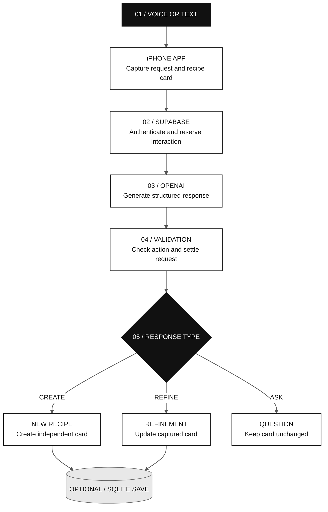

# prmpt. | AI Cooking Lab

**A conversational cooking app designed and built from interaction model to working iPhone implementation.**

What if making a recipe with AI felt like talking to someone in the kitchen rather than operating a recipe search form?

I designed and built **prmpt.** around that question. Users can describe what they want to cook, refine a recipe through conversation, ask questions without unintentionally changing it, and keep recipes they like. The product combines a minimal React Native interface with a server-side AI service and local recipe storage.

**This repository is a public technical companion, not the application source.** The original `cooking-ai` repository remains private. The code examples here are carefully selected, standalone adaptations of implementation logic, with invented data and no production configuration. They do not include a working AI connection or runnable mobile application.

[Explore the product](https://barbarakprokop.com/prmpt/) · [Product design portfolio](https://barbarakprokop.com/productdesign/) · [LinkedIn](https://www.linkedin.com/in/barbarakprokop/)

## The interaction problem

A traditional recipe app asks people to search, filter and select. A generic AI chat can help, but the conversation and recipe easily become tangled. prmpt. treats those as different types of interaction:

- **Create:** “I have chickpeas, spinach and lemon. What can I make?” produces a new recipe card.
- **Refine:** “Make it spicy, but no peanuts” updates the *specific* open card.
- **Ask:** “Can I prepare it the night before?” answers a question without changing the recipe.
- **Keep:** saved recipes remain local and independent of subsequent working edits.

The central UX decision is to **let conversation create and change structured recipe objects**, rather than treating every message as another paragraph in a chat transcript.

## Architecture

A compact overview of the request lifecycle. Black nodes mark the entry and decision points; the three outcomes preserve the difference between creating, changing and asking about a recipe.



This describes the observed design in the private code snapshot. It is **not a deployable reference implementation**; the actual authentication, API integration, payment handling and database migrations stay private.

## Selected implementation decisions

| Decision | Why it matters |
| --- | --- |
| Three explicit model actions | A recipe question should not mutate a recipe; a refinement should not create an unrelated card. |
| Stable card identity | If someone navigates to another recipe while AI is responding, the response still belongs to the original card. |
| Structured responses plus validation | Model output is treated as untrusted data before it can affect the UI. |
| Idempotent request identity | A retried request should not accidentally create a second paid generation. |
| Separate server-side AI access | API credentials are kept out of the iPhone app. |
| Local recipe persistence | Saving a recipe is separate from working-card revisions. |
| Explicit ingredient exclusions | Both server and client have conservative checks; **these do not guarantee allergy safety**. |

See [Design and architecture decisions](docs/design-and-architecture.md) for the reasoning and tradeoffs.

## Real logic, safely adapted

This companion includes small, testable examples derived from decisions visible in the private app's source:

- [`src/recipe-workspace.mjs`](src/recipe-workspace.mjs): independent recipe cards and targeted refinements.
- [`src/response-contract.mjs`](src/response-contract.mjs): checks three structured response types.
- [`src/request-identity.mjs`](src/request-identity.mjs): stable identifiers for retries tied to a captured card.
- [`examples/conversation.json`](examples/conversation.json): entirely invented cooking prompts and expected actions.
- [`tests/logic.test.mjs`](tests/logic.test.mjs): executable Node.js tests for the examples.

They are **adapted excerpts, not the full original modules**, and intentionally have no SDK dependencies, API endpoints, credentials or backend access. Run locally with Node.js 20 or newer:

```bash
npm test
```

## Technical context

**Design:** Interaction design, voice interaction, Figma, recipe card states and transitions  
**Application:** React Native, Expo, TypeScript, local SQLite  
**AI/backend:** Supabase authentication and Edge Functions, structured OpenAI responses, request quotas  
**Subscriptions:** RevenueCat integration, handled separately from the model interaction logic

The original codebase also contains tests for recipe state, AI response parsing, retry behaviour, and subscription safeguards. This public companion contains a smaller independent test set, not the full app's test suite.

## Limitations and current status

The private repository contains a working iPhone implementation and its backend code, but **this public companion cannot run the app or call a model**. It is intended to make selected product and technical decisions inspectable without distributing the product itself. App Store submission does not imply App Store approval. The current public release status should be checked on the [product page](https://barbarakprokop.com/prmpt/).

**Designed and built by Barbara K. Prokop**  
**PRODUCT DESIGNER & BUILDER · AI PRODUCTS & WORKFLOWS**

For security and reuse boundaries, see [SECURITY.md](SECURITY.md).
